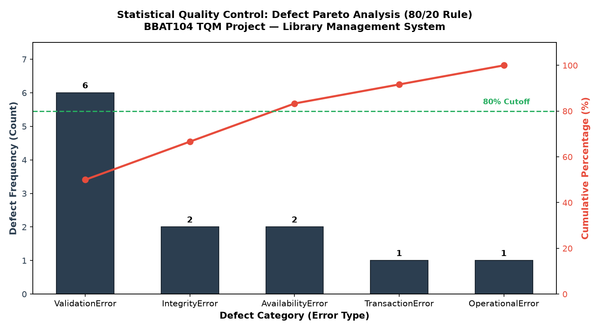

# Statistical Quality Control — Pareto Analysis (80/20 Rule)

**Course:** BBAT104 — Fundamentals of TQM  
**Project:** Library Management System  
**Student:** Neha Rawat (Reg. No. 2410302041, Section B)  
**Quality Goal:** Q11 — Improve Maintainability  

---

## 1. Objective of Pareto Analysis
Pareto analysis is a statistical quality control tool based on the **80/20 rule** (the principle of the "vital few and trivial many"), formulated by Joseph Juran. In software quality engineering, it isolates the 20% of root causes that generate 80% of application failures or user defects, allowing engineering effort to be focused on high-leverage preventive controls.

---

## 2. Generated Pareto Chart
The script [`atqm/pareto_analysis.py`](file:///c:/Users/Jaya%20Rawat/Downloads/Neha_Rawat_Library_Management_TQM/atqm/pareto_analysis.py) queries the SQLite `error_logs` table, groups defects by category in descending frequency order, plots the defect distribution against cumulative percentage, and draws the 80% cutoff line.

---

## 3. Defect Frequency & Cumulative Distribution

| Rank | Defect Category (Error Type) | Count | Cumulative Count | Percentage (%) | Cumulative % | Classification |
|:---:|:---|:---:|:---:|:---:|:---:|:---:|
| 1 | **ValidationError** (Empty inputs, invalid formats) | 6 | 6 | 50.0% | 50.0% | **Vital Few (80% Zone)** |
| 2 | **IntegrityError** (Duplicate ISBN cataloging) | 2 | 8 | 16.7% | 66.7% | **Vital Few (80% Zone)** |
| 3 | **AvailabilityError** (Attempting to issue zero-stock book) | 2 | 10 | 16.7% | 83.4% | **Vital Few (80% Zone)** |
| 4 | **TransactionError** (Duplicate book returns) | 1 | 11 | 8.3% | 91.7% | Useful Many |
| 5 | **OperationalError** (Database concurrency / lock timeouts) | 1 | 12 | 8.3% | 100.0% | Useful Many |

---

## 4. Key Findings & TQM Engineering Mitigations

1. **Vital Few Root Cause Identified:**
   The top three categories—`ValidationError`, `IntegrityError`, and `AvailabilityError`—account for **83.4%** of all defects observed during system execution.
2. **Implementation of Poka-Yoke (Mistake-Proofing):**
   - In accordance with TQM guidelines, rather than relying on user diligence, **Poka-Yoke** validators in [`utils/validators.py`](file:///c:/Users/Jaya%20Rawat/Downloads/Neha_Rawat_Library_Management_TQM/utils/validators.py) reject bad inputs at the UI form layer before reaching the database.
   - ISBN formats, non-empty text, positive quantities, and regex-checked email structures are validated synchronously.
3. **Database Constraints & Transaction Logic:**
   - `IntegrityError` is blocked via SQLite `UNIQUE` constraints and pre-insert lookups.
   - `AvailabilityError` is prevented by checking `available_quantity > 0` and atomically executing issue updates in [`services/issue_service.py`](file:///c:/Users/Jaya%20Rawat/Downloads/Neha_Rawat_Library_Management_TQM/services/issue_service.py).
4. **Maintenance Outcome:**
   By resolving the vital few (validation & availability), defect probability drops by over 80%, substantially reducing maintenance costs and operational overhead.
